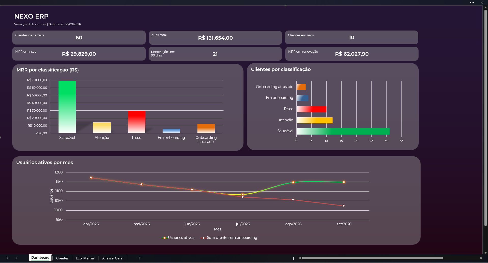

# Dashboard de Saúde de Clientes (Customer Success) – Nexo ERP

Projeto de estudo em Excel: análise da saúde de uma carteira de clientes de uma empresa fictícia de ERP em nuvem, no papel de analista de Customer Success.

> **Sobre os dados:** a base é fictícia e foi gerada com apoio de inteligência artificial. A análise e o dashboard foram construídos por mim no Excel.

## Objetivo
Identificar quais clientes estão saudáveis, quais precisam de atenção e quais correm risco de cancelar, e priorizar ações antes das renovações.

## O que foi construído
- **Health Score (0 a 100)** com 5 indicadores ponderados:
  adoção de usuários (30%), tendência de uso (20%), NPS (20%), chamados de suporte (15%) e módulos ativos (15%).
- **Classificação:** Saudável (≥ 70), Atenção (40 a 69) e Risco (< 40). Clientes em implantação ficam em categorias separadas ("Em onboarding" e "Onboarding atrasado"), porque a adoção no início é naturalmente baixa.
- **Tabelas dinâmicas** por classificação, CSM e faixa de renovação.
- **Lista de ação:** renovações dos próximos 90 dias, com ação sugerida por cliente.
- **Dashboard** com indicadores, MRR por classificação e evolução do uso.

## Principais resultados
- 10 clientes em risco, com R$ 29,8 mil de MRR (23% da carteira); todos renovam em até 90 dias.
- Esses clientes perderam 57% dos usuários ativos desde abril e estão há cerca de 90 dias sem contato do CSM.
- O total de usuários parece se recuperar, mas a alta vem só de clientes novos. Sem eles, o uso caiu 12,6%.
- 3 clientes com onboarding atrasado concentram R$ 12,4 mil de MRR.

## Estrutura do arquivo
| Aba | Conteúdo |
|---|---|
| Dashboard | Visão geral da carteira |
| Clientes | Base de clientes, indicadores e Health Score |
| Uso_Mensal | Logins e usuários ativos por mês (abr a set/2026) |
| Analise_Geral | Tabelas dinâmicas e lista de ação |

Data-base: 30/09/2026.

## Ferramentas
Excel: tabelas estruturadas, SOMASES, funções lógicas, tabelas dinâmicas, formatação condicional e gráficos.

## Próximos passos
Refazer o dashboard no Power BI e incluir análise de causas do risco.

## Autor
Alessandro de Souza Maia, [LinkedIn](https://www.linkedin.com/in/alessandrosouzamaia/)
